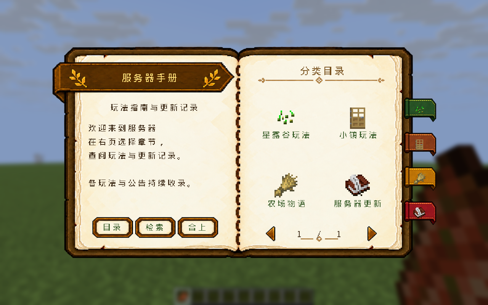

# HandbookCore

Minecraft / Folia **26.3** 的全局手册核心，当前版本 **Beta_0_1_0**，Java 25。
基于 Paper Dialog 展示双页书，支持任意贡献插件注册玩法分类、图文条目和服务器更新日志。



## 安装与构建

```bash
./gradlew :HandbookCore:build
```

产物自动留档到 `./release/HandbookCore/`：

| 文件 | 用途 |
| --- | --- |
| `HandbookCore-mc26_3-plugin-Beta_0_1_0.jar` | 服务端插件，已包含首次安装需要释放的 CE 资源 |
| `HandbookCore-mc26_3-plugin-Beta_0_1_0-api.jar` | 其他插件的编译依赖，不能放进 `plugins/` |
| `HandbookCore-CraftEngine-Beta_0_1_0.zip` | CE 资源目录，解压到 `plugins/CraftEngine/resources/` |
| `HandbookCore-mc26_3-plugin-Beta_0_1_0-install.zip` | 插件 + CE 资源 + 安装说明 + 逐文件校验表 |
| `HandbookCore-Beta_0_1_0-SHA256SUMS.txt` | 上述四个产物的 SHA-256 |

安装步骤见 [INSTALL.md](./INSTALL.md)。先让 CraftEngine 首次启动完成并释放内置 `internal` 包，
再安装手册资源，执行 `/ce reload all`，通过当前 CE 托管方式让玩家加载新资源包。
自动释放和 `/handbook install-resources` **只补缺失文件**；升级已有材质需备份后主动替换 CE 的 `handbookcore` 目录。

CraftEngine、MainMenu 都是可选依赖。缺少 CE、书页尚未注册或客户端回报资源包失败时，使用原生文字目录，保留检索、翻页与物品预览。
CE 若在登录配置阶段发包，Paper 可能没有游戏阶段的成功回执，因此 `book.require-pack-confirmation` 默认 `false`。
只在游戏阶段发包的服务器可设为 `true`，要求玩家已经确认加载资源包。

### 客户端白框与居中

点击整幅书本后出现的白框是客户端 `FocusableTextWidget` 的焦点轮廓。
可选安装 [MainMenuRepair](../../fabric-26_3-mod/MainMenuRepair/README.md) **Beta_1_2_0** 或后续版本：
只对手册正文隐藏焦点轮廓、整体居中并隐藏重复的灰色关闭按钮，保留鼠标和键盘交互。
纯服务端插件不能关闭这个客户端白框；未安装模组时书内按钮仍可使用。

书本画布为 520×288 GUI 像素。建议有效 GUI 画面至少约 560×340；画面较小时降低客户端 GUI 缩放。
实机验证采用 1280×800、GUI 缩放 2（有效 640×400），范围见 [VALIDATION.md](./VALIDATION.md)。

## 阅读与分页

- 首页每次显示 4 个分类；分类、检索结果每次显示 6 条文章。超过容量自动增加页数。
- 文章按 176 像素栏宽、每张纸 8 行排版，长文自动续到后面的纸页，每次展示两张纸。
- 底部 **`当前页 / 总页数`** 表示当前双页视图的进度，例如 `2 / 3` 表示三组双页中的第二组。
  原生文字回退按逻辑页显示，并明确标注当前页和总页数。
- 底部左右箭头翻页，悬停提示上一页、下一页或已到边界；左下方分别为目录、检索、合上。
- 右侧书签是独立的动态控件，带分类图标和选中态。每组 4 个，随首页或当前分类切换；其余分类通过首页翻页访问。
- 长标题与单行控件显示省略号，悬停可查看完整标题；正文自动换行。

## 命令与权限

`/manual` 是 `/handbook` 的别名。

| 命令 | 作用 | 权限 |
| --- | --- | --- |
| `/handbook` | 分类首页 | `handbookcore.use`，默认所有玩家 |
| `/handbook category <namespace:id>` | 打开分类 | 同上 |
| `/handbook open <namespace:id>` | 打开文章 | 同上 |
| `/handbook search [关键词]` | 输入检索词或直接搜索 | 同上 |
| `/handbook reload` | 异步重载 YAML，失败保留上次成功内容 | `handbookcore.admin`，默认 OP |
| `/handbook install-resources` | 补充缺失 CE 资源 | 同上 |
| `/handbook status` | 查看版本、分类/条目数量、CE 与书页状态 | 同上 |

分类和条目可另设 `permission`，空字符串为公开。目录、搜索和直接打开均检查权限。
搜索覆盖标题、摘要、关键词、正文和图片说明；空格分隔的多个词必须全部匹配，不区分英文大小写。
内部 `_nav` 是当前玩家会话的导航入口，不应手写或保存到配置。

安装 MainMenu 且 `main-menu.enabled: true` 时，自动注册「服务器手册」入口，位置交给 MainMenu 管理。

## YAML 内容

首次启动生成 `plugins/HandbookCore/config.yml` 与 `content/server.yml`。
核心递归读取 `content/` 下的 `.yml` / `.yaml`；默认收录星露谷、小镇、农场生活和更新日志的**可编辑入门示例**，
具体玩法规则应由运营者或相应玩法插件提供。单个 YAML 最大 2 MiB。

```yaml
categories:
  - id: example:farming
    title: 农场玩法
    description: 播种、收获与烹饪
    icon: WHEAT                         # 缺少 CE 图片时的原版图标
    image: example:farm_icon            # 可选，目录用 CE image
    bookmark-image: example:farm_small  # 可选，书签用较小 CE image
    order: 10
    permission: ''
entries:
  - id: example:planting
    category: example:farming
    title: 开始种植
    summary: 从种子到第一份收获
    keywords: [农场, 种植, 种子]
    order: 10
    permission: ''
    pages:
      - title: 准备工具
        blocks:
          - '<#79521e>选择种子</#79521e>'
          - type: image
            image: example:planting_picture
            width: 128
            height: 64
            alt: 种植步骤插图
          - type: item
            material: WHEAT_SEEDS
            ce-item: example:turnip_seeds
            caption: 种子预览
          - type: space
            lines: 1
          - type: link
            label: 阅读收获说明
            entry: example:harvesting
          - type: url
            label: 查看服务器官网
            url: https://example.org/guide
          - type: command
            label: 打开小镇
            command: town
            close-before-run: true
      - title: 浇水与收获
        blocks:
          - type: text
            text: 按照玩法插件的要求浇水和收获。
```

| 内容块 | 行为 |
| --- | --- |
| 字符串 / `text` | MiniMessage 正文，自动换行与续页 |
| `image` | 任意 CE 图片，指定实际显示尺寸，整体换页；缺失时显示 `alt` |
| `item` | 点击打开原生 Dialog 物品模型与悬停信息，支持完整原版 ItemStack、CE 物品及缺失回退 |
| `link` | 跳转手册内另一篇文章，目标再次检查权限 |
| `url` | HTTP(S) 网页，沿用客户端外链确认行为 |
| `command` | 以点击玩家自己的权限执行指令；默认先合上手册，便于目标指令打开其他界面 |
| `space` | 1..8 个空行 |

外链不接受本地文件协议和包含用户名信息的地址；指令去掉开头 `/`，不接受控制字符。
`command` 不使用控制台权限，不替玩家提权。`close-before-run: false` 适合只发提示等不切换界面的指令。
更新日志可单独存成一个 YAML，每篇独立条目，`order` 越小越靠前；按日期倒序可使用 `-20261026` 等值。

### CE 图片与图标

图片是运行时内容，书本底图不包含固定的分类插画。将自己的 PNG 放到对应 CE 包，例如
`plugins/CraftEngine/resources/example/resourcepack/assets/example/textures/gui/planting.png`，并定义：

```yaml
images:
  example:planting_picture:
    file: example:gui/planting.png
    height: 64
    ascent: 7
    font: example:handbook_images
    char: '\uE000'
```

`HandbookBlock.Image` / YAML 的 `width`、`height` 必须与该字形的实际 GUI 尺寸一致；核心不对任意 CE 字形运行时缩放。
单图显示范围为 **1..176 × 1..144**，较大配方或地图应按纸页拆成多个图片块。
CE 字形的源图单元不能大于 256×256；图集可用 CE 网格切分。独立图片推荐 `ascent: 7`。
正文也支持 `<image:example:planting_picture>` 和 `<shift:-4>`，普通插图优先使用显式 `image` 块，便于预留行高。

分类目录接受不超过 76×40 的 CE 字形，书签接受不超过 24×20 的小图；推荐分别提供 32 高和 16 高两份定义，
书签小图使用 `ascent: -1`。缺少图片或尺寸超限会改用 `icon` 原版图标。
原版图标引用客户端自带物品纹理，不向资源包复制 Mojang 原图；特殊 3D 模型的目录图标可能是代表贴图，
完整模型由 `item` 预览展示。

官方说明：[Paper Dialog](https://docs.papermc.io/paper/dev/dialogs/)、[CraftEngine 图片](https://xiao-momi.github.io/craft-engine-wiki/configuration/image/)。

## 插件 API

同仓库 `compileOnly project(':HandbookCore')`；其他仓库将 API jar 作为 `compileOnly files(...)`。
运行时依赖指向服务端的 HandbookCore，不要将 API 类打进自己的 jar。

```yaml
dependencies:
  server:
    HandbookCore:
      load: BEFORE
      required: true
      join-classpath: true
```

完整的注册例子：

```java
import com.example.handbookcore.api.*;
import java.util.List;
import java.util.Objects;
import org.bukkit.Material;
import org.bukkit.NamespacedKey;
import org.bukkit.plugin.java.JavaPlugin;

public final class FarmPlugin extends JavaPlugin {
    private static NamespacedKey key(String id) {
        return Objects.requireNonNull(NamespacedKey.fromString(id));
    }

    @Override public void onEnable() {
        HandbookCategory category = new HandbookCategory(
                key("farm:main"), "农场玩法", "种植与生活",
                HandbookIcon.image("farm:icon", "farm:icon_small", Material.WHEAT), 10, "");
        HandbookEntry entry = new HandbookEntry(
                key("farm:start"), category.id(), "种植入门", "第一份收获",
                List.of("播种", "浇水"), 10, "", List.of(
                new HandbookPage("准备种子", List.of(
                        HandbookBlock.text("准备好种子，再开垦土地。"),
                        new HandbookBlock.Image("farm:steps", 128, 64, "种植步骤"),
                        new HandbookBlock.Item(HandbookItem.craftEngine("farm:seeds", Material.WHEAT_SEEDS), "种子"),
                        new HandbookBlock.Url("服务器官网", "https://example.org/guide"),
                        new HandbookBlock.Command("前往小镇", "town")))));
        HandbookApi.service().replace(this, new HandbookContribution(List.of(category), List.of(entry)));
    }

    @Override public void onDisable() {
        HandbookService api = HandbookApi.serviceOrNull();
        if (api != null) api.unregisterAll(this);
    }
}
```

| API | 用途 |
| --- | --- |
| `HandbookApi.service()` / `serviceOrNull()` | 获取服务；也可用 Bukkit ServicesManager |
| `registerCategory(owner, category)` | 单独新增分类 |
| `registerEntry(owner, entry)` | 向已存在的分类新增条目，可跨插件贡献 |
| `replace(owner, contribution)` | 原子替换该贡献插件的全部内容，适合启动和重载 |
| `unregister(owner, id)` / `unregisterAll(owner)` | 只注销自己的内容 |
| `openHome(player)` / `openCategory(player, id)` / `openEntry(player, id)` | 打开相应页面 |
| `search(player, query)` | 打开检索结果 |

注册线程安全，定义与集合不可变，ItemStack 防御性复制。界面入口可从任意线程调用，核心切回玩家所属 Folia 区域。
不要在构造内容时进行玩家跨区域操作。服务端重启后内容由贡献者重新注册；贡献插件停用时核心也会自动清理其内容。
同名 id（分类和条目共用命名空间）拒绝注册；排序按 `order`、再按 id。
一次 `replace` 的所有分类与文章校验成功后才发布，失败保持旧快照。
移除分类后，其他插件留在该分类下的文章暂时隐藏；恢复分类后可再次显示。
注册数量没有固定的界面容量上限，实际容量受内存和内容复杂度约束，已验证的规模见验证记录。

## 美术与验证

- [素材来源与构建](./assets/README.md)
- [自动化与实机验证记录](./VALIDATION.md)
- [Dialog / CE 开发经验](../../docs/exp/handbook-dialog.md)
- [版本记录](./HandbookCore-mc26_3-plugin-ChangeLog-Beta.md)
