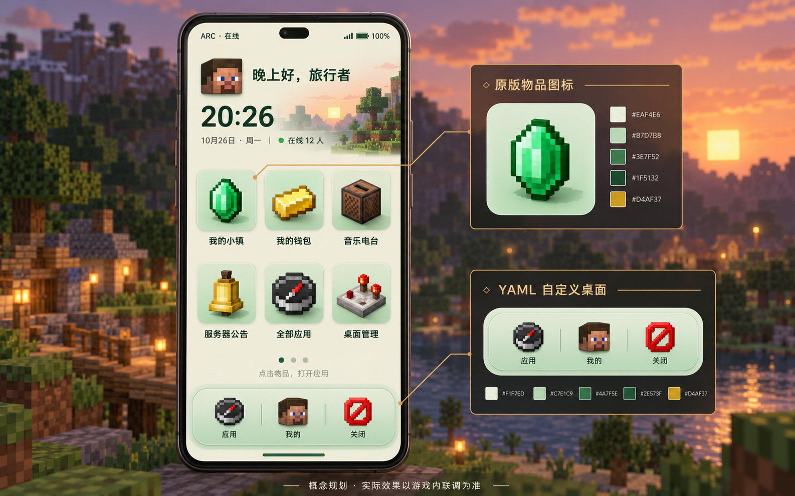

# 方块手机设计规划

## Beta_1_8_0 可选多侧卡

手机保留原暖象牙桌面，左右各留一列深青色卡片，薄荷细边、像素折角、原版物品图标和十格进度条形成科技感。
每列整体垂直居中；卡片按内容高度排布，容量不足时独立分页。数值刷新保持原坐标和实体。
全局开关默认关闭，固定技能和任务数值仅供管理员自行启用的示例，未接入实际星露谷技能数据。
实拍见 [六卡片示例](./screenshots/sidecards-multi.png) 与 [启用后的默认三卡片](./screenshots/sidecards-default.png)，
配置与插件注册说明见 [侧卡指南](../SIDECARDS.md)。侧卡使用原生显示实体，无新增图片贴图。

## 生图先行

- 日期：2026-10-26。
- 使用工具：Codex 内置 `image_gen.imagegen`，新图生成，非图片编辑。
- 用户方向：主菜单做成手机效果；先用生图规划，可以使用原版物品材质，主页由 YAML 控制。
- 概念图：[phone-concept.png](./design/phone-concept.png)。它是设计规划，非游戏截图。
- 原版物品、头像、几何面板和文字由游戏及 ArcMenu 渲染。概念图没有作为运行期贴图打包进插件。



## 对应实现

| 概念 | ArcMenu 实现 |
| --- | --- |
| 竖屏机身 | 居中的 256×434 设计区域；画布仍为 800×450、ppb 42.7 |
| 圆角屏幕、应用底板 | 不重叠的矩形带；标准 YAML 配色锚点统一改色 |
| 顶部状态栏 | ARC 字样、装饰信号和电池、相机形状 |
| 玩家问候、时钟 | 按查看者提供头像、名字、现实时间、日期、问候和在线人数 |
| 六个常用应用 | 绿宝石、金锭、唱片机、钟、指南针与书与笔；普通玩家的工具入口改为时钟 |
| 底部快捷栏 | 应用抽屉、我的、关闭；底部手势条返回桌面 |
| 应用列表 | 每页 12 项；功能图标材质动态提供，空位用淡灰玻璃片 |
| 管理 | 手机内标签、应用属性、固定位置选择和原生名称输入 |

图中的连续曲面、柔和阴影和背景景深属于概念表现。默认 UI 使用原生节点，圆角保留 Minecraft 的阶梯像素感；
未增加图片资源包。实际效果、像素校准和交互验证见 [VALIDATION.md](./VALIDATION.md)。

物品角度按用户提供的 UltimateShop-ArcMenu 1.0.0 核对并实测：头像、唱片机使用 `GUI`、Y=180°、Z 深度=0.1，
其它静态物品使用 `FIXED` 和三轴等比缩放。应用抽屉、管理和属性页统一使用 GUI + Y=180° + Z=0.1，
适用范围与字节码证据记录在仓库的 `./docs/exp/arcmenu-item-angles.md`。
概念中的比较器改为辨识度更高的书与笔；比较器在实际客户端使用原版平面贴图，底座较小，不能靠额外旋转增加贴图信息。
任意物品元数据仍受 ArcMenu 3.2 材质语法限制。

## 最终生图提示词

以下为调用内置工具时使用的完整提示词；`transparent_background=false`，无参考图。

```text
Create a polished high fidelity UI design planning image for a Minecraft in-world ArcMenu main menu, designed as a compact portrait smartphone interface. This is a UI mockup/concept, not code. Show ONE main phone at large readable size centered-left, plus two restrained small detail callouts on the right showing an application tile and the bottom dock. Canvas landscape 1600x1000 or similar. Background a softly blurred tranquil Minecraft overworld at dusk with trees and block terrain, low visual noise. Phone front is flat, straight-on and aligned, with slim dark graphite outer rim, subtly rounded corners, warm ivory inner surface, small top camera slit, elegant jade green and pale mint accents, restrained brass highlight. No inventory chest slot grid, no web sidebar, no browser window, no physical human hand. The full portrait panel must feel like a distinctive usable phone home screen built from flat rectangles, text, and visible native Minecraft item models. Clear typography with readable Simplified Chinese. Inside the screen from top to bottom: a tiny status bar 'ARC · 在线' with signal and battery marks, a friendly player greeting '晚上好，旅行者' with a compact square Minecraft Steve head avatar; a calm clock/weather style widget showing '20:26' large and '10月26日 · 周一' and '在线 12 人' small; a spacious 3-column by 2-row app launcher. App icons MUST be recognizable 3D PIXELATED MINECRAFT ITEMS floating above soft mint/cream rounded-square tile backplates, not generic modern app glyphs. First row: emerald labeled '我的小镇', gold ingot labeled '我的钱包', jukebox labeled '音乐电台'. Second row: bell labeled '服务器公告', compass labeled '全部应用', redstone comparator labeled '桌面管理'. Each icon is rendered large and crisp, consistent apparent size, with its short centered text BELOW the backplate. Native pixel texture aesthetic on item icons, refined modern UI chrome around them. Below launcher show discreet page indicator dots and a thin small hint '点击物品，打开应用'. Bottom dock is an inset pale jade pill with three separated native item models: recovery compass '应用', player head '我的', barrier '关闭'. A tiny home gesture bar underneath. Keep spacing generous and alignment exact. Callouts on the right use small clean Chinese annotation headings '原版物品图标' and 'YAML 自定义桌面' with only a few tidy swatches and one tile closeup; add the caption '概念规划 · 实际效果以游戏内联调为准' at bottom outside phone. Do not claim screenshot authenticity. Overall premium, composed, warm, tactile Minecraft phone UI; all on-screen elements should plausibly be implementable with ArcMenu text, rectangle and static item nodes, no gratuitous glossy gradients, no elaborate illustration wallpaper inside phone. Do not add extra random apps, branding logos, or excessive prose.
```
