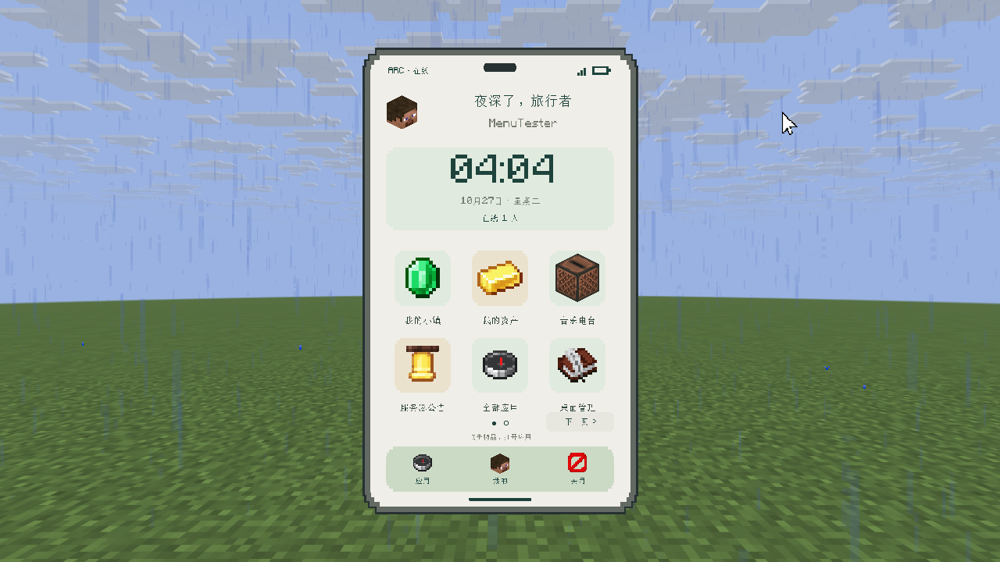
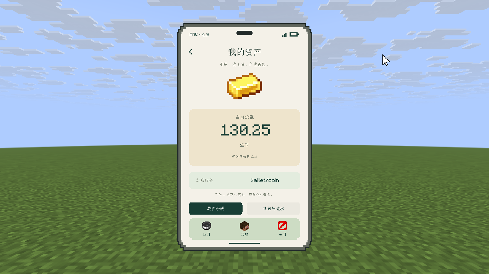
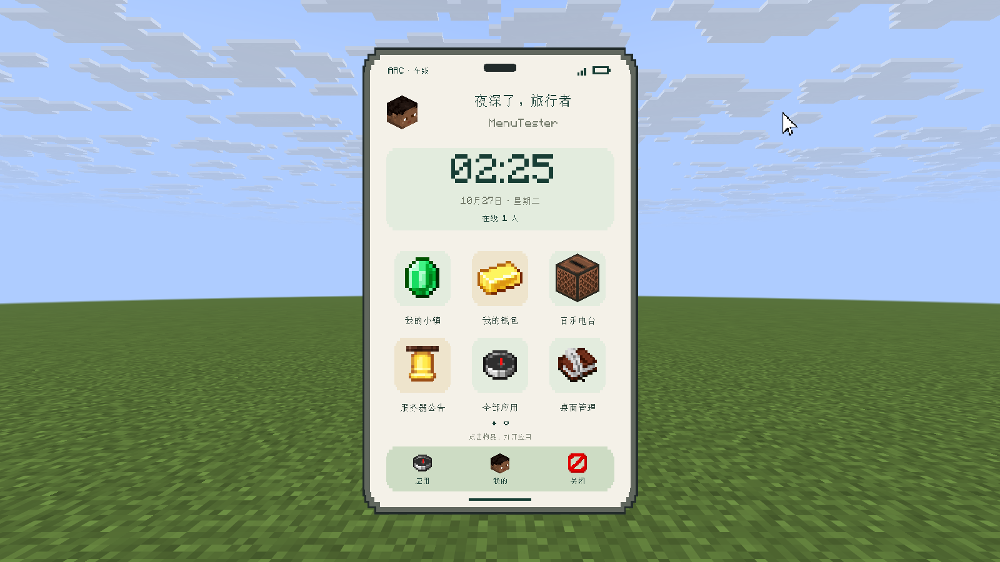

# MainMenu 方块手机验证记录

## Beta_1_7_0 更新验证（2026-10-26）

[本轮结构化结果与产物哈希](./vault-validation-results.json)。

- 独立 Folia 26.3 build 5 / Java 25 / ArcMenu 3.2.0 premium / 用户提供的 Vault 1.7.3-b0-folia / Wallet Beta_0_6_0 / Town Beta_0_7_1。未使用共用测试服。
- MainMenu 7 项 JUnit 全通过；38 项手机专项在本轮重新运行全通过，涵盖应用左右键、分页、管理权限与 YAML 不覆盖。
- 10 页模板校验并发布；主页“下一页”和页码圆点真实点击进入应用抽屉；原生资产页显示 Wallet/coin、130.25 金币；钱包详情真实进入“玩家货币”背包页。
- 玩家 textures 设为无效值时，主页、应用抽屉、我的和管理页仍正常打开；玩家及动态功能图标回退默认头。有效格式官方哈希在当前 ArcMenu 中可构建，未声称验证了真实在线账号皮肤下载。
- Vault / WalletApi 同账本与重启、模拟旧官网一次性迁入结果见 [Wallet 验证记录](../../Wallet/VALIDATION.md)。没有访问真实官网钱包。
- 本版截图为 1280×720、GUI scale 2；新增页面未沿用下方旧版 1600×900 的像素量测数值。





以下是 Beta_1_6_0 既有验证记录，其环境、截图和边界按原版保留。

## 环境与产物

- 验证日期：2026-10-26（America/New_York）；MainMenu `Beta_1_6_0`。
- 独立 Folia 26.3 build 5、Java 25、ArcMenu 3.2.0 premium；未使用共用测试服。
- Minecraft 26.3 Fabric 客户端，使用 MinecraftMcp 执行真实交互与截图；没有安装 ArcMenu Editor 或 Concerto 客户端。
- 窗口/截图 1600×900、GUI 800×450、GUI scale 2、FOV 70、菜单 distance 2、ppb **42.7**。
- 真实点击在 touch 模式验证；成品截图在 mouse 模式拍摄，隐藏游戏 HUD，光标移到手机外。
- 构建：Gradle 9.8.1 / Java 25，执行 `:MainMenu:build`；本次使用同版本本机缓存及 `--offline`，解决 wrapper 下载握手失败。
- 产物：`./release/MainMenu/MainMenu-mc26_3-plugin-Beta_1_6_0.jar`。哈希、测试结果和截图哈希见 [validation-results.json](./validation-results.json)。

## 功能验证

| 检查 | 结果 |
| --- | --- |
| 4 项 JUnit 配置测试 | 全通过：缺失模板释放、已有文件字节不变、9 页公共契约、动作与权限契约 |
| 迁移业务回归 44 项 | 全通过；在手机重排前验证原回调、管理状态、输入、逻辑分页、配置重载及回退。具体项目保留在结果 JSON 的独立分组 |
| 手机专项 38 项 | 全通过：桌面/Dock/手势、管理标签、显示、排序、固定位置、占位符、原生输入取消、普通玩家权限、12 项分页无遗漏与重复、左右键回调、独立管理分页、YAML 动作与时区 |
| 属性按钮层级修正后补充点击 | 真实点击 +1 生效，再恢复原排序值 |
| 无 ArcMenu 的实际启动 | MainMenu 正常启用；`/cd` 打开标题“主菜单”的背包 `ContainerScreen`，没有 ArcMenu 类加载错误 |
| 手机版主页重启保留 | 手改文件重启前后 SHA-256 相同；不是只检查文件存在 |
| 原生 YAML 校验 | 9 页正常发布；独立服全库 47 页校验通过 |
| 物品角度 | 头颅、唱片机显示顶部和正面；平面图标与空位玻璃板正常，未使用负深度 |

应用抽屉分页测试临时注册 25 个功能；拍摄最终截图前重启独立服清除测试注册。
“小镇”“钱包”“公告”“音乐”的桌面动作继续调用原功能插件；保留逻辑 54 位置、功能区 21 项和管理分类 16 项规则。

### 实测边界

- 钱包只验证 MainMenu 调用原功能回调；独立服未配置 Wallet 官网地址，没有验证实际经济读写。
- 音乐只验证入口回调与关闭主菜单；未安装 Concerto 客户端，没有验证其音乐界面。
- 独立服玩家为离线测试身份，头像使用可用的默认皮肤；没有验证正式账号的在线皮肤下载链路。
- 资源包自定义显示变换、任意 `ItemStack` 元数据不在无损转换承诺内；原背包回退保留完整物品。
- 9 页是当前 26.3 / ArcMenu 3.2 的验证结果，没有声称其它版本已支持。

## 像素量测

生成器应用 `G = 42.7 / 160.5 × 0.86`，矩形宽度系数 `1.01`、高度系数 `0.915`，保留各层透视补偿。
最终截图中，设计坐标转换为截图像素：

```text
x_px = 800 + (x_design - 400) × 1.72
y_px = 450 + (y_design - 225) × 1.72
```

按面板纯色（每通道容差 1）量测包含边缘的包围盒；14 个区域全部通过，最大误差 **0.744 设计单位**，低于 1.5。
下表列代表区域，完整期望坐标与实测坐标见结果 JSON：

| 区域 | 实测像素边界 `[左, 上, 右, 下]` | 最大误差（设计单位） |
| --- | --- | --- |
| 机身 | `[580, 76, 1020, 823]` | 0.442 |
| 内屏 | `[592, 88, 1008, 811]` | 0.465 |
| 时钟小组件 | `[618, 237, 982, 368]` | 0.674 |
| 底部快捷栏 | `[618, 715, 982, 786]` | 0.651 |
| 切换显示按钮 | `[816, 407, 958, 447]` | 0.744 |
| 转固定按钮 | `[805, 645, 958, 683]` | 0.535 |

截图检查还修正了属性页父面板与按钮底色同层的问题：面板 `z=0`、按钮底色 `z=1`、文字 `z=2`。
管理图标缩小到 24 设计单位，避免压住名称；所有节点 z 保持在 -3～3。
物品角度的附件参数、分类例外与实际适配见仓库的 `./docs/exp/arcmenu-item-angles.md`。

## 最终真实截图

以下均为游戏内原始截图；生图概念单独保存在 [DESIGN.md](./DESIGN.md)，没有混作运行期效果。



- [应用抽屉](./screenshots/apps.png)
- [我的](./screenshots/profile.png)
- [桌面管理](./screenshots/manage.png)
- [普通功能属性](./screenshots/attribute-function.png)
- [固定功能属性](./screenshots/attribute-fixed.png)
- [占位符属性](./screenshots/attribute-placeholder.png)
- [固定位置选择](./screenshots/position.png)
- [新建应用](./screenshots/custom.png)
