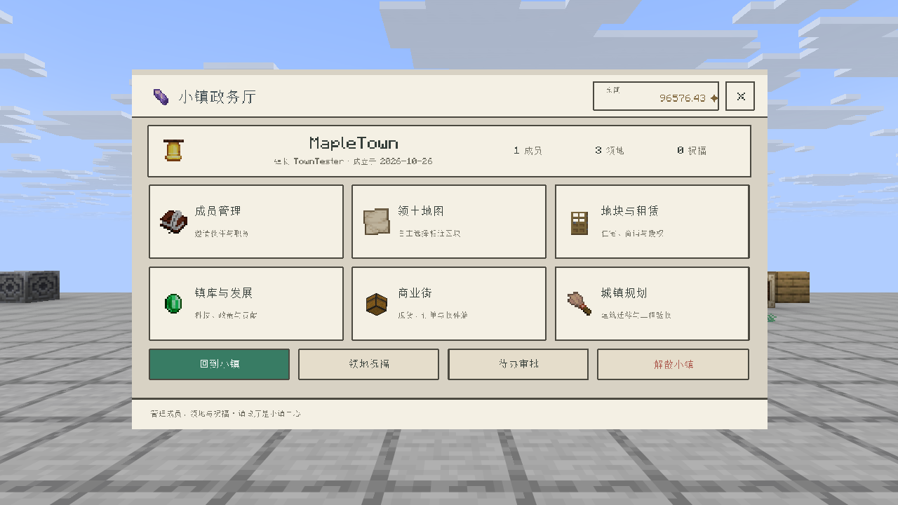
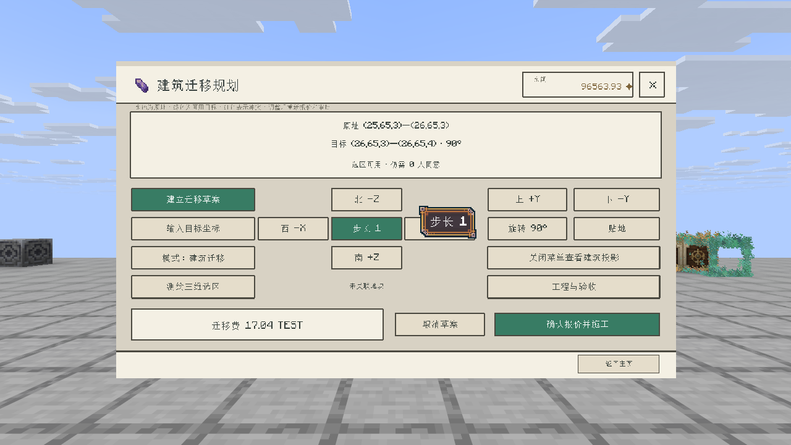

# Town（小镇）

面向 **Minecraft/Folia 26.3、Java 25** 的休闲经营小镇系统。以政厅核心和玩家自建建筑为中心，提供自主区块领土、XZ 矩形地块、出租与授权、镇库发展、玩家商业及建筑迁移。

- 版本：`Beta_0_7_1`，见 [ChangeLog](./Town-mc26_3-plugin-ChangeLog-Beta.md)。
- 主类：`com.example.town.TownPlugin`；公开查询接口：`com.example.town.api.TownApi`。
- [实机验证记录](./assets/VALIDATION.md) · [美术素材与原始提示词](./assets/README.md)。



## 依赖与安装

| 依赖 | 装有时 | 缺少时 |
| --- | --- | --- |
| ArcMenu 3.2 | 26 页世界内菜单、原生文本输入与每玩家动态内容 | 使用 `/town` 指令、聊天列表和文本地图 |
| Wallet / Vault Economy（二选一） | 成立、扩张、租金、镇库、商品及迁移结算 | 收费与钱包相关操作提示不可用 |
| CraftEngine | `town:town_hall` 核心、`town:surveyor` 测绘工具；保存自定义方块和家具 | 核心回落为磁石，工具回落为木棍；仍支持原版建筑迁移 |
| MainMenu | 主菜单注册 `town:main`，按查看者显示信息 | 使用 `/town` 打开 |

依赖均为软依赖。联合验证使用 Folia 26.3 build 5、Java 25、ArcMenu 3.2.0、CraftEngine 26.9.2；经济可选 Wallet 或向 Vault 注册的 Economy 服务。

1. 将 Town jar 与所需依赖放入服务端插件目录，启动服务端。
2. Town 首次释放 `plugins/Town/config.yml`，新增键有默认值，已有运营配置保留。
3. 自有 CraftEngine 资源在加载阶段释放到 `plugins/CraftEngine/resources/town/`，已有同名文件不会覆盖。等待 CE 延迟配置加载完成后，Town 自动执行 `reload_pack` 工作流（生成、校验、合并 ArcMenu、上传、发送）。客户端启用服务器资源包后重连即可。
4. ArcMenu 菜单自动生成到 `plugins/ArcMenu/menus/town-*.yml`。布局调整应修改生成器；Town 重载会重新生成菜单。

CraftEngine 已安装且配置了核心 ID 时，必须成功放置真实自定义方块；定义未加载时提示错误，不以原版方块代替成功结果。

### 资源包与领地地图

- `arcmenu resources` 只生成 ArcMenu 本地资源，必须继续执行 CE 合包和托管流程。默认支持 CE 26.9.2 的 `reload_pack` 工作流及其 ZIP 输出路径；工作流需保留 `generate`、`zip`、`upload` 和 `send_pack`。
- 地图只有在最终包包含当前 PNG 与字体映射，并且该玩家成功加载对应 SHA-1 / UUID 的资源包后才显示。等待、拒绝、下载失败时使用原版区块网格，仍可圈地；未安装 CE 时也使用网格。
- CE 配置阶段的下载不会触发普通玩家资源包事件；Town 在进入游戏后补发缓存包，取得可核验的加载回执。新增地形图会触发资源包更新，保留 30 秒节流和尾随构建。
- CE 原版默认使用与游戏共享端口的 HTTP 托管；本仓服务端打包默认改用下方 GitLab 分发。选择 `self` 时，局域网、端口映射或代理环境需要设置玩家能访问的 `resource-pack.self-host.ip` / `url`。见 [CE 托管文档](https://xiao-momi.github.io/craft-engine-wiki/getting_start/set_up_host/self/)。
- 已有服升级仅替换 Town jar，保留世界和 Town 数据目录；资源释放不覆盖已有 CE 自定义文件。

仅服务端打包脚本：`python3 ./scripts/package-town-server.py --base <上一版服务端ZIP>`。依赖 jar 来自指定的已交付最小包，Town 来自本仓留档，不夹带本机配置、世界、玩家数据或客户端。

### GitLab 分发

分发项目为 [yudream/mc-texture](https://gitlab.yudream.online/yudream/mc-texture)，项目 ID `51`；使用 CE 26.9.2 原生 `gitlab` host。完整流程为 ArcMenu 资源索引 → CE 生成/校验/合包 → GitLab 上传 → 向玩家发送 HTTPS 下载链接。

- [CE 配置片段](./deploy/craftengine-gitlab.yml) 合并到 `plugins/CraftEngine/config.yml`，保留现有工作流；`upload`、`send_pack` 的 `pack` 与此处均为 `default`。
- Java 进程需获得环境变量 `CE_GITLAB_ACCESS_TOKEN`，使用该项目的 Developer 角色和 `api` scope 项目访问令牌。启用 `use_environment_variables: true` 后，不在 YAML 中写入令牌。详见 [CE GitLab 文档](https://xiao-momi.github.io/craft-engine-wiki/getting_start/set_up_host/gitlab/)。
- 新服务端包的 `start.sh` / `start.bat` 可将根目录 `gitlab-token.txt` 的单行内容注入上述变量；也可由 `CE_GITLAB_TOKEN_FILE` 指定文件。复制示例文件后填写令牌，UTF-8 无 BOM；文件与真实环境变量均不参与打包。更换文件后重启 Java 进程。
- 已有服首次切换需设置上述环境变量并重启；后续配置修改可 `/ce reload host`、`/ce reload pack`。客户端保持服务器资源包“启用”。
- CE 使用项目 Uploads API 保存 ZIP，下载地址由上传响应返回；仓库网页、分支 raw 地址、Git 推送密码或仅有 `write_repository` 的令牌均不能直接代替这条上传链路。公开项目的实际 ZIP 链接需可匿名下载。
- 新地图继续触发自动上传和发送，保留 30 秒节流；地图就绪判断仍使用最终 PNG、字体映射及玩家加载回执。

打包默认生成带 `-GitLab` 后缀的新 ZIP；可用 `--host self` 生成内置托管包。支持以已交付的最小包为依赖来源，拒绝夹带真实令牌文件等额外内容。用 `--vault <Folia版Vault.jar>` 加入 Vault；`--economy vault` 可将 Town 默认来源设为 Vault，此时仍需另行安装经济提供者。分发验证见 [验证记录](./assets/VALIDATION.md)。

## 经济来源

默认 `economy.provider: wallet`，沿用 Wallet 多币种与原有业务号。使用 Vault 时，安装用户提供的 `Vault 1.7.3-b0-folia` 与兼容当前 Folia 的经济插件，修改配置并重启：

```yaml
economy:
  provider: "vault"
  currency: ""
```

Vault 提供统一接口，余额由注册到它的 Economy 提供者保存。只安装 Vault 时，Town 保留免费功能并提示经济未就绪；服务晚于 Town 注册也可识别。`/town admin economy` 可查看实际来源。配置修改需重启，本次启动不会自动改用另一提供者。

- 成立、圈地、祝福、贡献、镇库提现、租金、现货、预付订单、离线结算及迁移退款共用所选来源。使用 UUID 对应的 `OfflinePlayer` 账户，在线操作在玩家实体线程执行，离线账户操作在 Folia 全局线程执行。
- Vault 使用提供者的单一全局货币，忽略 `economy.currency`；内部币种按 `vault:<注册插件>:<提供者>` 独立保存，余额旁显示提供者货币名称。不是 Vault 银行账户或多世界子账户接口。
- Town 金额保持两位小数。提供者只支持整数或一位小数时，不符合精度的交易会拒绝；不会静默取整。超出 double 可精确表达范围的金额也会拒绝。
- 每笔交易记录经济来源；旧版无标记的交易属于 Wallet。切换来源不会转换镇库、商铺、订单、租约或未完成交易，旧款项须在原来源结清；不同来源的币种不能互相支付。

### Vault 中断与核对

Vault API 没有幂等业务号。Town 在调用前写 `vault-transfers.bin`，收到明确成功后写回执，重启可复用成功结果。调用抛错、返回部分金额或成功回执写盘失败时，交易保留待核对，自动恢复不会重复调用经济插件。

管理员（`town.admin`）先核对外部经济账本，再执行：

```text
/town admin economy pending
/town admin economy resolve <交易UUID> <debit|credit|refund> <success|failed|retry>
```

- `success`：确认该步已完成，仅记录成功并继续本地业务，不再移动资金。
- `failed`：确认该步未完成且不再处理；扣款步骤将拒绝本次业务，收款/退款步骤仍保留待结算。
- `retry`：确认该步没有发生资金移动、允许重新发送。正在调用和已成功记录不能重发。明确拒绝的收款步骤可在解决账户问题后用此操作继续。

已有玩家被挂起的交易结清后会解除忙碌状态。备份须同时保存 Town 数据、Vault 适配台账、提供者经济账本与世界；不能通过删除台账处理异常。

接入与恢复边界的原因见 [Vault 经济经验](../../docs/exp/town-vault-economy.md)。

## 成立、政厅与领土

1. `/town create 名称` 进入筹备，可邀请成员，也可单人起步。
2. 人数达到 `town.min-members` 后确认成立；新安装默认 **1 人、1000 货币**，人数包含镇长。Wallet 币种由 `economy.currency` 指定，空值取启用货币；Vault 使用提供者的单一货币。
3. 镇长放置政厅核心，登记中心与回镇传送点；政厅建筑由玩家自行搭建。
4. **首次仅领取核心所在区块**。默认赠地总额为 9 块，余下 8 块由玩家在地图中自主选择；领取记录持久化，迁址不会重复赠送。
5. 新区块必须与现有领土相连，默认四向连接，可配置斜角。放弃区块不能切断政厅与其他领土的连接，不能遗留个人地块。
6. 核心不能直接挖回，需使用专门的政厅迁址服务。

`claim.max-chunks` 为区块总上限，`0` 表示不限；永久科技可增加区块容量。免费额度用完后每块默认 50 货币。

旧 `towns.yml` 已有自动赠地区块保留；有政厅的旧镇标记为已领取且剩余额度为 0，不再额外赠送。旧配置仅有 `founding.free-claim-radius` 时，将半径折算为赠地总额度。

## 矩形地块、出租与保护

地块使用 **XZ 方块级矩形、覆盖全部 Y 高度**，不必按区块对齐。保存稳定 ID、名称、用途、业主、授权、公开交互、出租报价和有效租约。

| 用途 | 规则 |
| --- | --- |
| `RESIDENTIAL` 居住 | 住宅及个人建造、储物 |
| `COMMERCIAL` 营业 | 可开设现货商铺和预付收购单 |
| `PRODUCTION` 生产 | 农场及生产建筑，按同一授权规则保护 |
| `PUBLIC` 公共 | 由小镇管理者管理，不可作为私人房产出租；核心所在位置只可划为公共地块 |

- `/town select` 领取测绘工具，左键、右键方块设置两角，也可用准星指令 `select pos1|pos2`。
- 镇长或官员划分地块；矩形必须完整位于本镇领土内，不能重叠。
- 边界可扩大、缩小、迁址。预览显示新旧轮廓，提交前原归属继续生效。
- 缩小或迁走他人产权地块、影响有效租户时，需要对应审批；修改方案和资料版本后重新核验。ID、授权和租约保留。
- 有商铺或订单的地块不能直接改边界、用途或移除；建筑迁移服务可联动更新经营资产。
- **外镇玩家也可承租**。租金一次性结算给业主，到期恢复业主权限；租期内建造、容器及授权按租户控制，镇长身份不直接覆盖私人权限。
- 开放访客交互只开放交互权限，容器和建造仍需授权。`town.bypass` 为管理员保护绕过权限。

领土保护还覆盖桶、爆炸、跨界活塞、火焰、展示框、盔甲架、矿车箱、实体破坏、跨地块漏斗和 CraftEngine 操作。施工锁独立于普通保护绕过权限。

## 镇库、科技与政策

成员可贡献镇库，镇长可提取；余额按币种保存，贡献排行与流水可在菜单查看。永久科技和限时政策由镇库支付。

| 默认项目 | 效果 |
| --- | --- |
| 城镇规划 `planning` | 每级增加 16 个区块容量，最多 5 级 |
| 政务档案 `archives` | 每级增加 1 个政策槽位，最多 4 级 |
| 搬迁物流 `logistics` | 每级减少 5% 迁移费，最多 5 级 |
| 丰收协约 `harvest` | 24 小时成熟原版作物产量期望增加 15%，不复制种子 |
| 工匠互助 `builders` | 24 小时急迫 I、迁移费减免 10% |
| 商业繁荣 `commerce` | 24 小时交易手续费减免 20%；默认 5% 费率变为 4% |

科技价格为基础价乘以下一级等级。政策默认 2 槽，最大 6 槽；同政策续购延长时长。范围支持 `MEMBERS`、`RESIDENTS`、`ALL`，居民包含本镇成员、产权业主和有效租户。效果按对应镇域生效，迁移费及商业优惠在报价和提交时重验。

迁移折扣默认封顶 70%，丰收加成默认封顶 50%；价格、时长、槽位和效果均可配置。旧领地祝福仍可使用，并与政策药水效果统一施加。

## 玩家商业与收件箱

- **现货商铺**：站在有经营权限的营业地块中，主手拿商品并填写数量和单价；发布时移走并托管实际商品。
- **预付收购单**：主手样品定义完整商品数据；发布时预付全部金额，供应者须交付相同数据的商品。
- **离线结算**：经营者下线仍可成交；卖方收入、供应奖励和未使用预付款结算到对应钱包。
- **收件箱**：购买、订单收货和下架剩余库存进入持久收件箱；领取先保存背包，再减少邮件数量。
- **报价确认**：校验库存版本、数量、单价及净到账；手续费政策变化后需重新预览。
- **迁移联动**：施工期间相关商铺停止交易；验收后更新商铺锚点与地块，恢复交易。

保存完整 ItemStack，包括自定义名称、附魔和物品组件。交付用背包前后镜像记录意图，期间冻结相关背包操作；冲突时保留记录，管理员核对后恢复。

## 建筑迁移服务



1. 测绘建筑完整三维范围，包含所需地板、屋顶、容器及家具碰撞范围。
2. 建立草案或输入目标坐标；原址金色、可用目标绿色、冲突红色。关闭菜单可查看自定义方块投影。
3. 方向按钮步长可切换 1 / 5 / 16，支持上下移动、90° 旋转、贴地和重新报价。
4. 源区和目标必须属于同一小镇。关联地块时保持完整 XZ 覆盖，取得需要的业主、租户及管理者同意；调整后原同意失效。
5. 确认价格后锁定区域、再次检查、保存快照，再扣费施工。世界读写进入 Folia 区域线程，按 `blocks-per-tick` 分批处理。
6. 完成后进入待验收，可走入检查；建造和容器继续锁定。验收提交地块、商铺及政厅坐标，撤回恢复原址并退款。
7. 重启后按工程日志重放未完成写入，保留快照和施工锁；异常工程暂停，修复原因后可重试。

默认费用：20 + 非空气源方块数 × 0.05，政厅迁址另加 100，再应用折扣。默认最大体积 65536 方块、投影上限 2048 方块，均可配置。

支持原址重叠移动、原版旋转状态、容器内容、告示牌及 PDC；CE 方块保存 ID 和属性，家具保留原实体并移动、旋转。家具显示实体可能在重载时重建，恢复使用核心实体身份。

预检拒绝玩家、动物及普通实体障碍，未完整包含的门、床、双箱和家具，以及传送门、活动活塞部件、带独立方块实体的 CE 方块、CE 组合门/床、不支持的 CE 连接方向旋转。其他插件自行维护的世界外部数据没有通用迁移适配。

## 菜单与指令

26 页菜单采用暖象牙、玉绿与黄铜配色，覆盖成立与成员、真实领土地图、地块、镇库、采购、商业、收件箱、审批、迁移规划和工程验收。无需 PlaceholderAPI，动态内容按每玩家 META 写入。

余额的金额和币种分行展示，镇库页使用同样的金额区块；超出栏宽的金额带 `≈` 缩写，长币名显示省略号，悬停可查看完整金额、币种和当前来源。查询失败显示“暂不可用”并间隔重试，不将失败值显示成余额。普通物品图标使用 FIXED 正面，箱子和头颅使用 GUI + Y 180° + 正深度；成员操作高卡片采用上下排布。实机校准与样例见 [菜单布局经验](../../docs/exp/town-menu-layout.md)。

`pixels-per-block` 保持 **42.7**，视觉和命中区按 70% 居中缩放。玩家可用 `/arcmenu mode` 选择本服和客户端支持的输入模式。文本走 `ArcMenuTextInput`：本次未装 ArcMenu Editor 的客户端使用铁砧输入，填写后点击右侧结果提交；其他客户端方式由 ArcMenu 决定，原生模式上限 50 字符。

下表均以 `/town` 为前缀：

| 入口 | 常用子命令 |
| --- | --- |
| 基础 | `create 名称`、`found`、`invite 玩家`、`accept`、`reject`、`members [页]`、`leave`、`disband` |
| 成员 | `kick|transfer|promote|demote 玩家` |
| 领土 | `claim`、`unclaim`、`map`、`claimmap center`、`spawn` |
| 选择 | `select`、`select pos1|pos2|clear` |
| 地块 | `plot list`、`plot info ID`、`plot create 用途 名称 [业主]`、`plot edit ID`、`plot confirm|approve 提案ID` |
| 授权出租 | `plot trust|untrust ID 玩家`、`plot rename|kind|public ID 值`、`plot transfer ID 玩家`、`plot offer ID 金额 天数`、`plot unoffer|rent ID` |
| 镇库 | `civic donate|withdraw 金额`、`civic technology|policy ID`、`civic ledger|contributions|payments` |
| 商业 | `market stock|order 数量 单价`、`market list`、`market buy|supply ID 数量 版本 单价分`、`market close ID 版本` |
| 收件箱 | `market mail`、`market collect 收件ID 数量`、`market resume` |
| 迁移草案 | `move begin X Y Z [地块ID]`、`move hall X Y Z`、`move shift X Y Z`、`move rotate|ground|status|cancel` |
| 工程审批 | `move jobs|approvals`、`move inspect|approve 方案ID`、`move accept|undo|retry 工程ID` |
| 祝福查询 | `buffs [页]`、`buff buy ID`、`info [名称]`、`list` |
| 管理 | `reload`、`admin givehall`；交付冲突核对后 `market resolve 在线玩家 before|after` |

施工确认使用当前方案生成的带令牌报价命令。经营菜单内部 `/town manage …` 走同一服务校验。玩家参数支持在线名或 UUID。

| 权限 | 默认 | 说明 |
| --- | --- | --- |
| `town.use` | true | 基础功能 |
| `town.admin` | op | 管理、工程恢复与交付冲突处理 |
| `town.bypass` | op | 普通领土和地块保护绕过 |
| `town.reload` | op | 重载配置 |

## 数据、恢复与验证

| 文件（相对服务端根目录） | 内容 |
| --- | --- |
| `plugins/Town/config.yml` | 运营配置，已有值保留 |
| `plugins/Town/towns.yml` | 成员、领土、赠地、地块、租约、镇库、科技政策及流水 |
| `plugins/Town/payments.bin` | 持久交易状态、原业务号和退款状态 |
| `plugins/Town/vault-transfers.bin` | Vault 调用意图、成功回执与人工核对状态 |
| `plugins/Town/market.json` | 托管商品、预付款、交易、收件箱和背包交付意图 |
| `plugins/Town/relocations/` | 每工程日志和压缩的源区/目标区快照 |

快照和原子替换防止旧数据覆盖新数据；交易先持久登记再推进。Wallet 使用原业务号恢复，远端须保持幂等语义；Vault 使用本地调用回执，结果不明时进入上述核对流程。备份时停服并同时保存 Town、所选经济提供者账本与世界。实机验证范围见验证记录，未连接正式网站经济服务。

```bash
./gradlew :Town:test :Town:build
python3 ./Minecraft-26_3-plugin/Town/assets/rebuild_textures.py --check
```

73 项单元测试及 Folia 联调范围见 [验证记录](./assets/VALIDATION.md)。公开 API 保留 TownApi 与 Founded / Disbanded / Claim / Unclaim / BuffActivate 事件。ArcMenu 经验见 [知识库](../../docs/exp/arcmenu-yml知识库.md)。

红名、监狱、守卫、节庆、战争、税收、SQL 与跨服同步属于后续范围。
