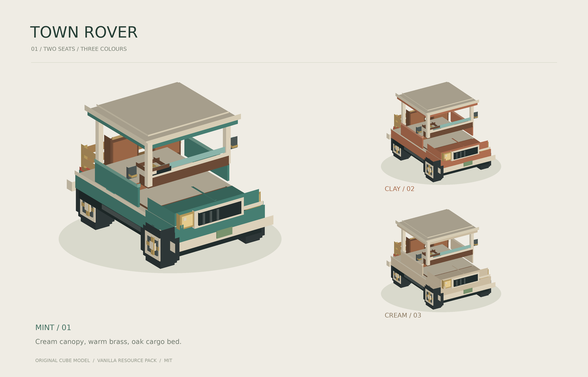

# Vehicles · 小镇漫游车

Folia **26.3 / Java 25** 双人载具原型，当前版本 `Beta_0_1_0`。
服务端插件负责驾驶，普通原版客户端加载资源包即可显示；客户端不需要载具模组。

## 当前功能

- 原创复古双座小车，薄荷绿 `mint`、陶土橙 `clay`、奶油白 `cream` 三种配色。
- 奶油白顶棚、棕色座椅、木质货斗、方向盘、后视镜、暖色车灯与独立转动车轮。
- 车主驾驶，其他玩家坐副驾驶；管理员也可驾驶他人的车。
- W/S 油门、制动倒车，A/D 转向，空格刹车，Shift 下车，右键车身上车。
- 加速、惯性、倒车限速、碰撞阻挡、重力和最高 0.6 格台阶；行驶中显示速度。
- 每名玩家一辆车，服务器默认最多 12 辆；收车或车主退出后清理组件。
- MainMenu 存在时注册“小镇车库”帮助入口；CraftEngine 存在时可安装资源到其合包目录。

## 安装

完整安装 ZIP 在 `./release/Vehicles/`，解压到服务器根目录。

1. 将插件 JAR 放到 `plugins/`，使用 Folia 26.3 / Java 25 启动。
2. 使用 CraftEngine 时，安装包已经包含 `plugins/CraftEngine/resources/vehicles/`；执行 `/ce reload all`，沿用服务器现有资源包分发流程。
3. 独立使用时，将 ZIP 内 `resourcepacks/` 下的载具资源包配置为服务器资源包，或放进客户端 `resourcepacks/` 并启用。
4. 在平坦、开阔的地面使用 `/vehicles spawn`，右键车身或 `/vehicles ride` 上车。

插件也会将独立资源包释放到 `plugins/Vehicles/`。
CraftEngine 资产只在文件不存在时安装，保留运营者的已有修改；升级时如需替换自定义资产，应先备份后手动更新。

## 命令与权限

| 命令 | 用途 |
| --- | --- |
| `/vehicles`，别名 `/car` | 查看操作说明 |
| `/vehicles spawn [mint\|clay\|cream]` | 在前方放置一辆车，默认薄荷绿 |
| `/vehicles ride` | 乘坐五格内最近的小车 |
| `/vehicles leave` | 下车，也可以按 Shift |
| `/vehicles despawn` | 收回自己的车 |
| `/vehicles status` | 查看版本、车辆数与自己车辆的位置 |
| `/vehicles reload` | 重载驾驶参数与数量上限 |

`vehicles.use` 默认所有玩家可用；`vehicles.admin` 默认 OP，可重载配置并驾驶他人的小车。
配置位于 `plugins/Vehicles/config.yml`，默认最高前进速度约 27 km/h、倒车约 10 km/h。

## 原型范围

车辆目前是会话内的免费试用载具，车主退出或服务器重启后收回。
货斗是外观装饰，车灯是模型材质；当前没有可存物后备箱、动态照明、燃料、购买、持久车库或车损。
地面碰撞采用保守的包围盒，不能攀爬整格高墙；水和岩浆作为障碍物处理。
尚未实现车辆之间及车辆与生物的物理碰撞，也未完成高并发压力测试。
支持 `/vehicles reload` 更新配置；更换 JAR 请重启服务器。

## 模型与构建

- 可编辑模型：`./Minecraft-26_3-plugin/Vehicles/assets/source/town_rover.bbmodel`，用 Blockbench 打开。
- 原版模型与纹理：`./Minecraft-26_3-plugin/Vehicles/assets/resourcepack/`。
- 从原创几何重新生成：`python3 ./Minecraft-26_3-plugin/Vehicles/assets/generate_models.py`，需要 Pillow。
- 构建与测试：`./gradlew :Vehicles:test :Vehicles:build`。
- 打完整安装包：`python3 ./Minecraft-26_3-plugin/Vehicles/tools/package.py`。
- 模型来源与许可见 `./assets/SOURCES.md`；实机验证见 `./assets/VALIDATION.md`。

测试夹具 `TestPluginVehicles` 只在 `:Vehicles:vehicleIntegrationJar` 中生成，不进入正式 JAR 和安装包。
