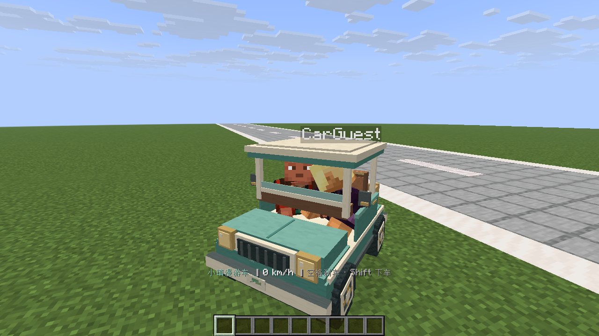

# Vehicles Beta_0_1_0 验证记录

日期：2026-10-27。目标为 Minecraft / Folia **26.3 build 5**、Java **25**。

## 环境与方法

- 在模块独立的 `./build/integration/drive/` 中启动本机测试服，未修改共用测试服。
- 两个 26.3 客户端通过 MinecraftMcp 执行真实按键、右键交互和截图；测试模组只用于操作与观察，载具运行不依赖客户端模组。
- 服务端仅装 Vehicles 和独立的 `TestPluginVehicles` 观测夹具；没有安装 MainMenu 或 CraftEngine。
- 客户端启用独立载具资源包，原版立方体模型、纹理、座位和车轮在实际游戏中检查。
- `TestPluginVehicles` 不在正式 JAR、资源包和安装 ZIP 中。

## 构建与单元测试

`./gradlew :Vehicles:test :Vehicles:build` 通过，8 项驾驶物理测试覆盖：

1. 前进与倒车各自限速。
2. 空格刹车停止且不变成倒车。
3. 最高速度不能穿过薄墙。
4. 半砖可上，整格障碍不可上。
5. 无人驾驶时滑行停止且不持续漂移。
6. 下落后落地。
7. 倒车转向随行驶方向变化。
8. 同时按前后不加速。

本机 wrapper 下载曾遇到 TLS 失败，最终使用已经安装的同版本 Gradle 9.8.1 / Java 25 离线构建。

## 双客户端实机结果

| 场景 | 结果 |
| --- | --- |
| 三种配色 | mint、clay、cream 均实际生成；模型没有缺失纹理，车头朝向与行驶方向一致 |
| 双人乘坐 | 车主驾驶、普通玩家乘副驾驶；座位位置与第一人称道路视线正常 |
| 前进与跨区块 | 连续前进 46.48 格，经过多个区块；两位乘员的 Y/Z 跟随一致 |
| 刹车 | 空格后速度归零 |
| 倒车 | 实际倒退 5.72 格 |
| 转向 | 转至 53.20°，产生对应横向位移 |
| 下车 | 副驾驶 Shift 下车后站在地面 Y=65 |
| 右键上车 | 非 OP 玩家右键 Interaction 命中区域成功上车 |
| 控制权 | 副驾驶按 W 不驱动车辆；车主重复生成被拒绝 |
| 墙体碰撞 | 砖墙位于 Z=78，车辆中心停在 Z=76.603，速度归零 |
| 乘客掉线 | 普通乘客被踢出后，车辆和驾驶者保留；继续前进 7.932 格后正常刹停 |
| 主动收车 | 检查覆盖车辆位置的 4 个区块，组件从 9 个降为 0 个 |
| 有车停服 | 保留一辆车和驾驶者停服，最终日志无 Vehicles 异常，正常保存世界 |
| 重启回收 | 重启后回到原位置并加载周边区块，车辆数 0；组件扫描 0；附近实体查询无车辆组件 |

每辆车有 9 个服务端实体：2 个座位 ItemDisplay、1 个车身 ItemDisplay、4 个车轮 ItemDisplay 和 2 个 Interaction。
组件扫描覆盖 X 区块 −1..0、Z 区块 0..1；生命周期回归的车辆停在 `(0.5, 64.988, 6.8)`，全部组件在该范围内。

## 实机截图

- `./screenshots/driver-seated.png`：驾驶位第一人称。
- `./screenshots/passenger-driving.png`：行驶时副驾驶视角。
- `./screenshots/wall-stop.png`：撞墙后停止。
- `./preview.png` 是原创模型几何生成的配色预览，上面的截图来自游戏客户端。

## 排查与修复

- 修正展示模型 FIXED 旋转 180°，使车头、前轮转向和世界前进方向一致。
- 修正方块碰撞形状的坐标转换；将局部 VoxelShape 平移到方块世界坐标。
- 发现并修复乘客断开连接时原版删除根载具的问题；退服事件中先脱离托管座位，再处理车主的车辆回收。
- 发现并修复 Folia 停服线程上删除实体的空世界上下文异常；停服时交由服务端清理不持久化组件。
- 早期测试曾出现一次 Folia watchdog 调度线程停驻记录，没有 Vehicles 调用栈；最终生命周期两轮未复现，未据此声称完成长时间稳定性或压力验证。

## 验证边界

- MainMenu 注册和 CraftEngine 素材安装已构建检查，本轮实机未验证这两个可选依赖的联动或 CE 合包分发。
- 半砖、重力与整格阻挡包含单元测试；实机碰撞针对平路和砖墙，未遍历全部方块形状、坡道或复杂地形。
- 未做跨独立 Folia 区域的高并发、多车压力测试；没有车辆间/生物碰撞、燃料、经济、存物与持久车库。
- 本轮属于双人驾驶原型验证。车主退出或服务器重启后车辆收回。

调试原始记录在已忽略的 `./build/integration/drive/`，实现经验见仓库 `./docs/exp/vehicles.md`。
