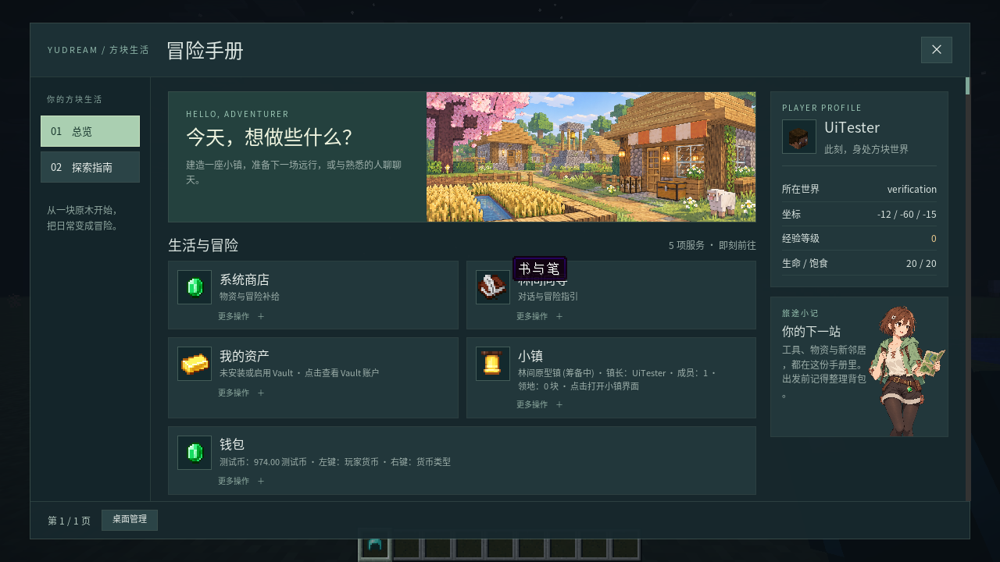
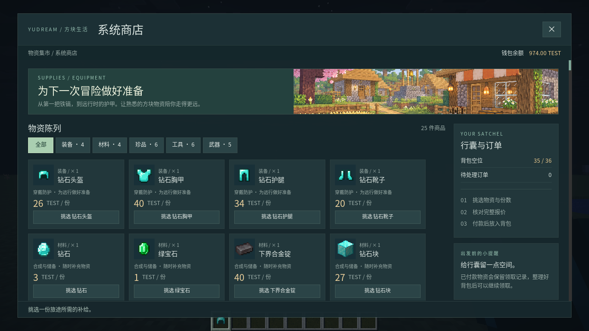
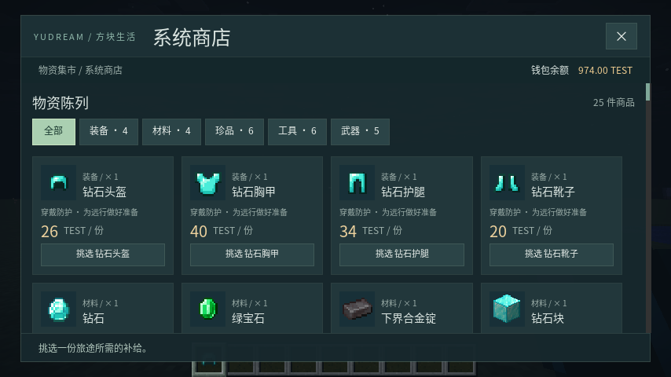
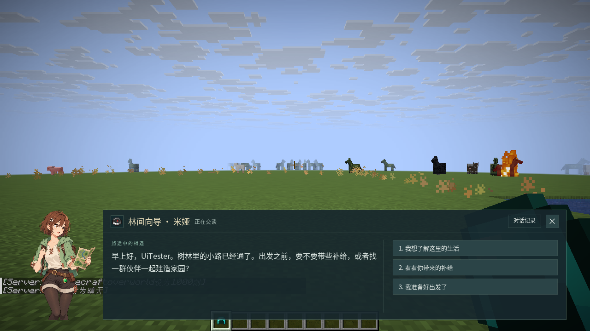
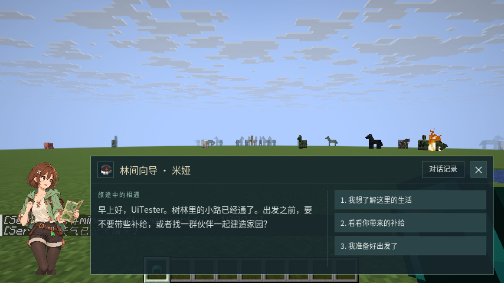
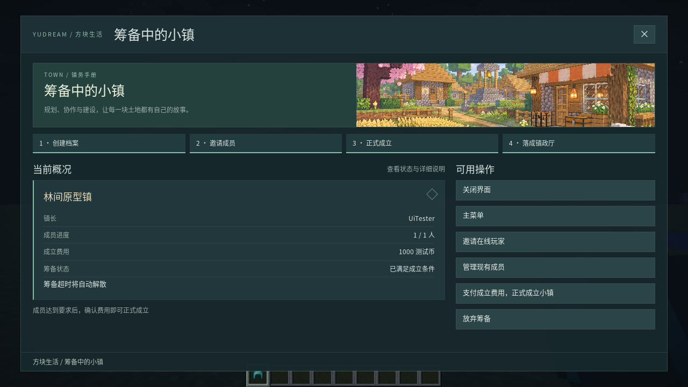
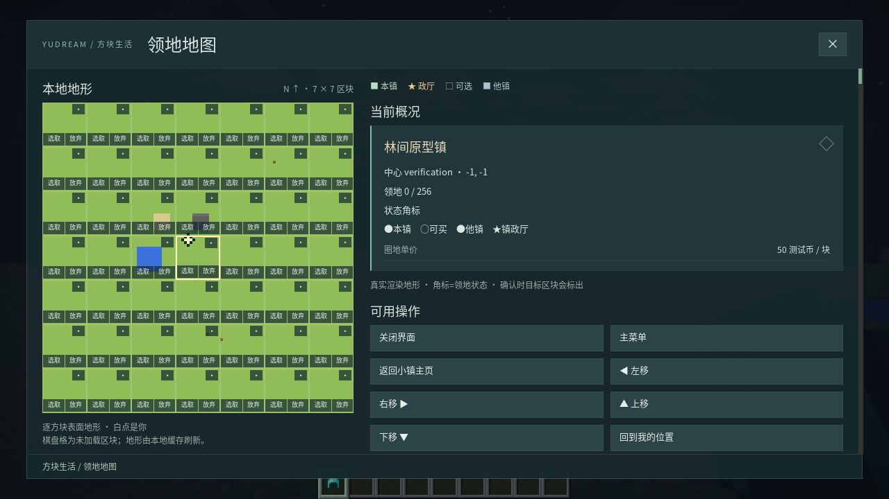
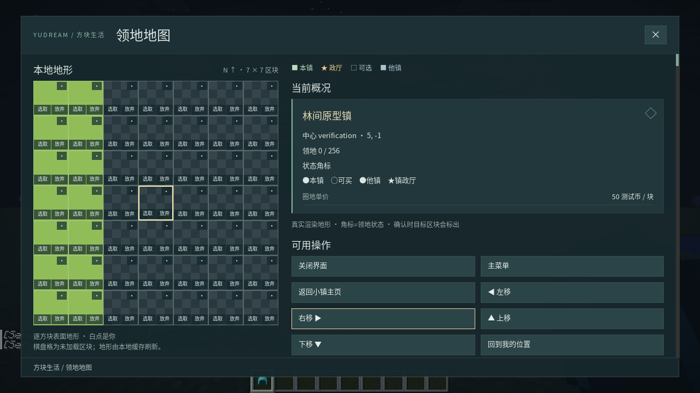

# Beta_0_2_0 视觉与交互验收

2026-10-28，Folia / Minecraft **26.3**。采用 Minecraft 日常村庄与二次元向导，原版物品和游戏世界保留。旧版本基础验证见 [VALIDATION](./VALIDATION.md)，新素材来源与最终提示词见 [DESIGN](./DESIGN.md)。

## 交付与实测范围

- 插件与 Fabric Mod：`Beta_0_2_0`；MainMenu `Beta_1_10_0`、Town `Beta_0_11_0`。
- 实机：Ubuntu x86_64、SDL X11、Vulkan llvmpipe、Java 25，GUI scale 2。窗口 **1280×720 / 854×480**；新页面分别用 1280×720 / 854×480 布局坐标，游戏 GUI 坐标仍为 640×360 / 427×240。
- 隔离测试玩家 UiTester、测试 Wallet 的 TEST 币；没有部署到共用 `./run/`。
- 留档与实机 JAR 哈希相同，见 [artifacts.sha256](./validation/visual/artifacts.sha256)。

## 实机结果

| 验证 | 结果与证据 |
| --- | --- |
| 五种页面与缩窗 | 主菜单、商店、RPG、Town、7×7 领土布局通过；商品分类切换保持同一 revision，即本地即时执行。[报告](./validation/visual/atlas-visual.json) |
| 真实购买 | 1000→974 TEST，获得 1 个钻石头盔，持久订单 DELIVERED。[报告](./validation/visual/atlas-purchase.json) |
| 原生输入 | 精细坐标模式输入“方块日常🐱”，数量滑条读数同步；没有提交测试自定义功能。[报告](./validation/visual/atlas-input.json) |
| 底部向导 | 1280×720 顶部保留 456 像素（63.3%），854×480 保留 264.4 像素（55.1%）；三项回答全部可见，记录限制在原框内，分支、结束与商店跳转通过。移除原版全屏暗化后，开关 UI 截图确认场景保持原亮度。[报告](./validation/visual/atlas-dialogue.json) |
| 本地地形 | 负坐标中心 -1,-1；沙地/水面/石台可区分，改为红色混凝土后页面 revision 不变、对应像素变色，恢复沙地后像素恢复；平移 6 块，35 块未加载显示棋盘格；确认页坐标匹配，854×480 地图完整可见；未变化时复用纹理。[报告](./validation/visual/atlas-terrain.json) |
| 旧组件回归 | 密度 1 的演示页计数、中文/Emoji、标签、滚动、模态、键盘、缩窗仍通过。[报告](./validation/visual/native-functional.json) |
| 主题热更 | 两个图片版本、分类状态保留、坏哈希保留原页面、缓存复用；Minecraft 资源包重载增量 0。[报告](./validation/visual/atlas-hot.json) |
| 物理移除 Mod | 四个入口自动使用 Inventory，数量使用原版 Dialog；1000→974 TEST 并获得钻石头盔。[报告](./validation/visual/no-mod-functional.json)；[圈地入口回退](./validation/visual/no-mod-terrain.json)也通过。 |

本次 YudreamUI 插件 5、protocol 9、runtime 8 项自动化测试全部通过，合计 **22 项**。新增原生分类状态、数值读数/无效目标、地形范围限制与裁剪、Town 中心坐标解析回归。MainMenu / Town 源码没有改动，本轮没有重跑其全部业务单元测试；沿用上一版 24 / 100 项基线，不把它们算成本轮实跑。

## 真实客户端截图

### 主菜单



### 系统商店





### RPG 对话





### 镇务



### 本地地形与圈地





截图使用隔离平地世界，沙地、水面和石台为验证用小样。地形颜色来自实际区块，不是生成插画。软件 GPU 上本次最大单块采样约 1.19ms，仅是该样例观测值，不代表硬件性能保证或最坏上限。

更多：[商品详情](./validation/visual/screenshots/atlas-shop-quantity.png)、[付款确认](./validation/visual/screenshots/atlas-shop-confirm.png)、[对话记录](./validation/visual/screenshots/atlas-dialogue-history.png)、[中文输入](./validation/visual/screenshots/atlas-input.png)、[主菜单缩窗](./validation/visual/screenshots/atlas-mainmenu-narrow.png)、[对话缩窗](./validation/visual/screenshots/atlas-dialogue-narrow.png)、[本地地形与领地网格](./validation/visual/screenshots/atlas-town-map.png)。

## 边界与复跑

当前仍只有 Linux x86_64 原生产物。没有新声称 Windows/macOS 支持、真实 OS IME 候选窗通过，或已达到箱子菜单延迟。这里验证的是视觉、点击与业务流程；软件 GPU 的帧耗时不能代替真实硬件性能对照。

素材村庄为示意；圈地图底图来自客户端已加载区块，状态与权限来自 Town。未加载区域显示棋盘格，不主动请求地形；只画表面，未提供洞穴或地狱层切换。当前没有活动/新闻插件数据接入，未虚构排行或活动流。通用旧菜单接管仍依赖原动作和条件支持范围，并非任意 Arc YAML 的完整重建。

```bash
python3 ./fabric-26_3-mod/YudreamUI/integration/atlas.py visual
python3 ./fabric-26_3-mod/YudreamUI/integration/atlas.py dialogue
python3 ./fabric-26_3-mod/YudreamUI/integration/atlas.py terrain
python3 ./fabric-26_3-mod/YudreamUI/integration/atlas.py inputs
python3 ./fabric-26_3-mod/YudreamUI/integration/atlas.py purchase
python3 ./fabric-26_3-mod/YudreamUI/integration/atlas.py hot
```

只在已经准备好的隔离夹具运行；purchase 修改 TEST 余额/背包，hot 临时启动回环 HTTP 服务并在结束后恢复配置，terrain 在隔离平地世界构建少量沙地/石台/水面并临时改变采样方块。no_mod 的前提为物理移除 YudreamUI Mod。复跑不会为全新机器自动下载所有依赖。
