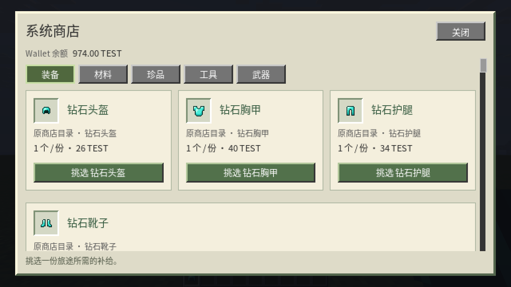
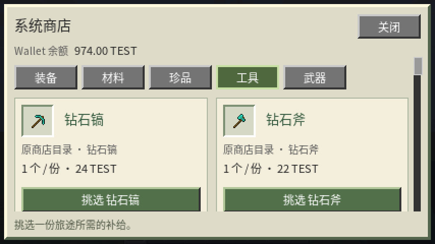
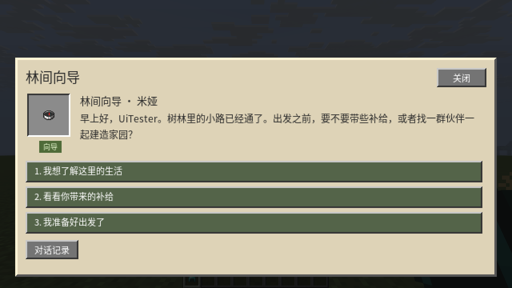

# YudreamUI 原型验证

本页保留 `Beta_0_1_0` 基线记录；`Beta_0_2_0` 的视觉、坐标映射与交易/素材回归见 [视觉验收](./VALIDATION-VISUAL.md)。

验证日期：**2026-10-27**。版本为 YudreamUI plugin / Fabric `Beta_0_1_0`、MainMenu `Beta_1_10_0`、Town `Beta_0_11_0`。这是隔离环境的功能验收，尚未完成跨平台发布或箱子菜单延迟对照。

[安装说明](./README.md) · [迁移范围](./MIGRATION.md) · [HTML 与协议](../../fabric-26_3-mod/YudreamUI/PROTOCOL.md)

## 环境与产物

| 项目 | 实际环境 |
| --- | --- |
| 服务端 | Folia 26.3 build 5，API `26.3.build.5-alpha`，Java 25 |
| 客户端 | Minecraft 26.3，Fabric Loader 0.20.0，Fabric API 0.165.0+26.3 |
| 渲染 | RmlUi 6.3 / JNI；Ubuntu 26.04 x86_64，glibc 2.43；SDL X11；Vulkan llvmpipe 软件设备 |
| 尺寸 | 游戏窗口 1280×720、854×480；GUI scale 2，对应 640×360、427×240 |
| 业务 | MainMenu、Town、ArcMenu 3.2、Wallet 测试模式；仅使用 TEST 测试币 |
| 隔离 | `./fabric-26_3-mod/YudreamUI/build/integration/`；独立世界、离线测试玩家、配置与端口 |

没有对共用 `./run/` 的世界、运营钱包或现有菜单配置应用迁移。客户端原生库只验证了上述 Linux 环境；Windows、macOS、ARM、其它 Linux ABI 和真实硬件 GPU 未验证。

四个交付 JAR 的 SHA-256 见 [artifacts.sha256](./validation/artifacts.sha256)。仓库根可执行：

```bash
sha256sum -c ./Minecraft-26_3-plugin/YudreamUI/validation/artifacts.sha256
```

## 自动化测试

以下目标构建成功；全部 **141 项通过、0 失败、0 跳过**。计数来自 Gradle JUnit XML，汇总在 [unit-summary.json](./validation/unit-summary.json)。

```bash
./gradlew :YudreamUI:build :MainMenu:build :Town:build --offline
./gradlew -p ./fabric-26_3-mod/YudreamUI build --offline
```

| 模块 | 项数 | 主要范围 |
| --- | ---: | --- |
| YudreamUI 插件 | 4 | 订单重启恢复、重复交付状态、损坏文件拒绝加载、未知条件关闭执行 |
| protocol | 8 | Unicode 分片与乱序、非法帧、HTML 编译约束、语义字段和伪造动作校验 |
| runtime | 5 | 空资源路径、哈希缓存与损坏拒绝、真实 RmlUi 布局/输入/热替换、模态焦点、隐藏标签滚动恢复 |
| MainMenu | 24 | 原有注册、位置、分页、显示与按键业务回归 |
| Town | 100 | 原有小镇、经济、经营、科研、迁移等业务回归 |

MainMenu / Town 原有测试数量不代表新显示层的所有页面均经过点击穷举。真实显示与路由另外使用 MinecraftMcp 驱动游戏客户端验证。

## 真实客户端验证

| 路径 | 已确认的结果 | 记录 |
| --- | --- | --- |
| 原生控件 | 中文与 Emoji 码点输入/保存；本地计数；Enter 单次激活；标签、开关、滑条、滚动、模态焦点；缩窗后状态保持；内置界面外部请求为 0 | [native](./validation/native-functional.json) |
| 图片和字体热替换 | 两组版本替换，输入/开关/滑条/标签/滚动/计数保留；错误哈希保留旧页面且可继续点击；同哈希复用缓存；测试期间资源包重载增量为 0 | [assets](./validation/assets-functional.json) |
| 无原生渲染后端 | inventory 状态更新保留原容器；Shift/交换/丢弃拦截；Dialog 表单中文提交后返回；Dialog 动作与 Escape；TrMenu 不可用时恢复 inventory | [fallback](./validation/fallback-functional.json) |
| RPG 与真实购买 | 分支与记录、对话进商店；1000→988 TEST、获得 8 个面包且订单 DELIVERED；满背包不建单/扣款；余额不足记 DECLINED | [business](./validation/business-functional.json) |
| MainMenu / Town | 主菜单进 Town；镇名原生输入、重新打开回填、Escape 返回；开始筹备持久保存；原生确认页、管理页与 7×7 网格 | [business](./validation/business-functional.json) |
| 移除 YudreamUI Mod | MainMenu、Town、RPG、商店自动 inventory；Dialog 数量输入；25 项目录；1000→974 TEST、获得 1 个钻石头盔 | [no-mod](./validation/no-mod-functional.json) |
| 最终菜单接管 | `/arcmenu open shop-tools` 进入统一系统商店；分类切换、管理页、对话记录；49 格的购买/放弃共 98 个控件；854×480 商店截图复核 | [takeover](./validation/final-takeover.json) |
| 最终产物核对 | 安装的四个 JAR 与留档哈希一致；普通玩家可打开内置界面、不能打开管理员素材演示；恢复管理员后素材、主菜单和商店原生打开 | [artifact smoke](./validation/final-artifact-smoke.json) |

`business` 使用四商品开发目录验证交易边界；随后切换为迁移的 25 项目录，完成无 Mod 购买与原生浏览。无 Mod 测试物理移除了 YudreamUI JAR，保留 Fabric API / MinecraftMcp 作为观察和输入工具，未测试全新原版启动器安装流程。中文文本由真实客户端事件路径提交，尚未验证操作系统 IME 的候选窗和预编辑流程。

### 截图

系统商店，原 Arc 购买目录：



缩窗后两列布局：



RPG 对话：



其它界面：[对话记录](./validation/screenshots/dialogue-history-final.png)、[主菜单](./validation/screenshots/mainmenu-final.png)、[管理页](./validation/screenshots/mainmenu-manage-final.png)、[镇名草稿](./validation/screenshots/town-draft-final.png)、[确认页](./validation/screenshots/town-confirm-final.png)、[领地网格](./validation/screenshots/town-map-final.png)、[无 Mod 商店](./validation/screenshots/no-mod-shop.png)、[无 Mod 购买完成](./validation/screenshots/no-mod-purchase-final.png)、[素材第二版](./validation/screenshots/assets-version-2.png)。

## 模板与第三方桥的范围

已对夹具中 MainMenu 10 页、Town 26 页的 **652 个点击配置**检查动作/条件结构，当前没有不支持项。输入 SHA-256 与逐页结果在 [template-audit.json](./validation/template-audit.json)。这是生成模板的静态兼容检查，不证明 36 页全部业务、权限组合、用户自定义 YAML 或第三方脚本都可接管。未知构造仍交回原渲染器。

TrMenu 3.12.6 的实际启动卡在动态依赖引导：TLS 握手失败、`kotlin210.Lazy not found`，见[错误摘录](./validation/trmenu-bootstrap.txt)。因此只确认了不可用时 inventory 恢复，**没有确认 TrMenu 完整运行链路**，也不能据此判断其与 Folia 26.3 不兼容。随包 YAML 仅覆盖 showcase 的 buy/save/slow；其它业务拒绝套用该模板并回到 inventory。

## 复跑与剩余边界

联调工具在 [integration](../../fabric-26_3-mod/YudreamUI/integration/)，启动条件见[客户端 README](../../fabric-26_3-mod/YudreamUI/README.md#隔离联调)。当前启动器依赖本仓 Town 已准备的客户端缓存，不是新机器一键运行包。报告与截图为本次运行快照；完整带清理的 MCP 记录留在被忽略的夹具 evidence 中，不提交令牌、客户端账号或世界数据。

`verify.py business` 要求新建的隔离 Town 数据和四商品演示目录，会创建小镇、改测试余额与背包；`no_mod` 要求先停客户端并移除 YudreamUI Mod，使用 25 项目录和 TEST 币种。不能对运营实例直接执行。

- 未测同硬件/网络下箱子菜单的端到端延迟、长时间负载、多玩家区域并发或断网压力；本地控件不等待服务端不能代替性能基准。
- 订单文件恢复经过自动化验证；未做进程断电注入。Wallet 与玩家背包不是同一事务，交付不确定仍需人工核对，见[订单说明](./README.md#wallet-商店)。
- 领地网格没有地形贴图；Arc 装饰、声音、动画、侧卡、任意脚本及自定义物品组件不在自动翻译范围。
- HTML 支持受约束的 XHTML/RCSS 和声明式动作，不包含浏览器 JavaScript / React。新游戏版本、其它原生平台和真实 OS IME 均需后续独立适配验证。
