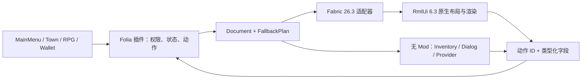

# HTML、协议与扩展接口

## 数据流



只有声明的动作和字段能回到业务回调。原生本地状态与服务器权威状态分别处理；余额、权限和物资交付不依赖客户端展示值。

## XHTML → RML

这是 **经过约束的 XHTML 和 RmlUi RCSS 子集**，不是浏览器 HTML/CSS 引擎。必须有一个 `html` / `rml` 根和一个 `head`、`body`；标签须闭合，属性须加引号；禁止 JS、`on*`、DTD、外部实体、CSS `url()` / `@import` / `@font-face`。

可使用 div/span/p/h1/h2/h3、section/main/header/footer/nav/form、label/button/input/textarea/select/option、img/br/progress，以及下表组件。Flex、百分比尺寸、min/max、滚动与 `@media` 由真实 RmlUi 执行；语法和限制见 [RmlUi media queries](https://mikke89.github.io/RmlUiDoc/pages/rcss/media_queries.html)。没有 React、DOM JS、浏览器 Grid 或任意 npm 页面直接运行能力。

| 组件 | 用途 |
| --- | --- |
| `mc-panel` / `mc-card` | 方块边框面板 / 信息卡 |
| `mc-button` | 按钮，`action` 声明操作 |
| `mc-input` / `mc-checkbox` / `mc-slider` | 文本、布尔、范围输入 |
| `mc-progress` / `mc-badge` | 进度 / 标签 |
| `mc-scroll` | 纵向滚动容器，需给高度约束 |
| `mc-slot item="minecraft:bread"` | 原版物品渲染；不是可拖动背包槽 |
| `mc-terrain` | 本地已加载区块的逐方块地表，需 `terrain:local-1` |
| `mc-tabs` / `mc-tab` | 本地标签切换 |
| `mc-modal` | 遮罩、焦点约束、Escape 返回 |

最小文档：

```html
<html>
  <head>
    <title>小镇补给</title>
    <style>
      .shell { width:85%; max-width:600px; height:80%; }
      .body { height:70%; overflow-y:auto; }
      @media (max-width:450px) { .shell { width:98%; height:95%; } }
    </style>
  </head>
  <body>
    <mc-panel class="shell">
      <h1>小镇补给</h1>
      <p id="balance" bind="balance" fallback-label="余额"></p>
      <mc-input id="memo" aria-label="备注" maxlength="40"/>
      <mc-button id="buy" action="server:buy" input-ids="memo"
          fallback-icon="BREAD" aria-label="确认购买">确认购买</mc-button>
      <mc-button id="close" action="ui:close">关闭</mc-button>
    </mc-panel>
  </body>
</html>
```

`fallback-label` 可为降级按钮提供含价格/数量的独立文案，原生按钮仍用 aria-label 与可见正文。`bind` 替换为转义文本。输入字段只通过按钮的 `input-ids` 提交，并由 `FallbackPlan` 校验类型、长度、范围；服务器仍需做业务校验。ID 只用字母、数字、下划线、连字符，最长 64 字符。

动作：

- `server:<id>`：回到服务端预注册处理器，**不是任意命令**。
- `tab:<id>`：本地切换同 ID 的 `.tab-page`；标签项使用 `.selected`。
- `filter:<category>`：本地筛选 `filter-category` 对应元素，`filter:all` 显示全部；按钮加 `.filter-button`，选中项加 `.selected`。需 `atlas:2`。
- `toggle:<id>`：本地显示/隐藏目标；`mc-modal` 会同步管理焦点。
- `count:<id>`：本地增加数字，用于演示或本地显示。
- `ui:close`：关闭会话。

稳定 ID 支持热替换后保留输入、勾选、滑条、标签、滚动与本地计数；删除/改名 ID、切换会话或不兼容布局不保证保留。

`<html ui-density="2">` 为精细排版页面，布局/断点尺寸为 Minecraft GUI 尺寸的两倍；适配器同步转换渲染、裁剪、物品、输入和辅助控件坐标。省略时为 1，仅接受 1/2。新页面需要 `atlas:2` 客户端；不要把高分辨率布局尺度与操作系统缩放或帧率混为一谈。`value-target="某ID"` 可让输入/滑条把当前值显示到只有文本的 span/p，热替换会同步恢复；忽略自身、祖先和包含其它控件的目标。

## 素材无感更新

### 本地地形组件

```html
<mc-terrain id="terrain" dimension="minecraft:overworld"
    chunk-x="-1" chunk-z="-1" chunks="7"
    style="display:block;width:448px;height:448px;"/>
```

`chunk-x` / `chunk-z` 是中心区块坐标；`chunks` 为 1～15 的奇数，坐标含半径必须在世界边界内。北在上，西在左，每块 16×16 像素，宽高建议相同。RmlUi 提供布局与裁剪，版本适配器提供本地表面颜色、明暗和玩家白点；未加载区域为棋盘格，维度不匹配时不读取其它世界。组件不发送点击或任意指令，领地状态和操作用同位置的 HTML 控件叠加，并照常由服务器确认。

最多 4 个地形视口、512 个区块缓存；游戏连接/世界切换后清空，不落盘。只查询客户端 chunk cache，不主动加载区块；每 tick 限制采样数量和时间，变化后才上传纹理。没有地形能力的客户端由服务端生成状态网格或语义降级。

### 图片与字体清单

`Document.assets` 为可选 JSON 数组：

```json
[
  {"id":"banner","kind":"image","hash":"<64位小写SHA256>","url":"https://cdn.example/ui/banner.png"},
  {"id":"display","kind":"font","hash":"<64位小写SHA256>","url":"https://cdn.example/ui/display.ttf"}
]
```

图片用 ``，字体用 `font-family:asset-font-display`。清单 ID 保持不变、内容与 SHA-256 改变时，客户端下载并校验新内容，准备好后替换当前文档；先保留旧文档和可用控件。URL 由运营方托管，插件不自动建立公网 CDN。空清单不扫描缓存、不下载、不更新全局资源。

只接受 HTTPS，不跟随重定向。客户端显式设置 `-Dyudreamui.allowLocalHttp=true` 时才允许回环 HTTP 联调。每份清单最多 16 个资源，单资源 8 MiB，总原始与解码图片各 32 MiB，图片最大 2048×2048；连接内最多 32 个外部字体版本、32 MiB 外部字体。当前磁盘缓存没有自动容量淘汰，可在退出游戏后清理客户端 `config/yudreamui/cache/`。

素材只进入 UI 自己的纹理/字库，不替换物品模型或 Minecraft 全局资源。新图片几何采用 GPU 完成栅栏后回收；字体版本保留至断线，超过预算拒绝更新并保留原页面。

## 服务器 API

`compileOnly project(':YudreamUI')`，在 `paper-plugin.yml` 声明 YudreamUI `load: BEFORE`、`join-classpath: true`。从 Bukkit ServicesManager 获取 `YudreamUiApi`。

```java
var ui = Bukkit.getServicesManager().load(YudreamUiApi.class);
player.getScheduler().run(plugin, task -> {
    var state = new JsonObject();
    state.addProperty("balance", "120 coin");
    var document = new YudreamUiApi.Document("小镇补给", html,
        new JsonArray(), state, Set.of("server:buy"));
    ui.open(player, document, (viewer, action) -> {
        // 此处已在 viewer 区域线程；先校验权限、价格和库存。
        String memo = action.form().get("memo").getAsString();
        handlePurchase(viewer, memo);
    });
}, null);
```

`open` / `patch` / `close` / RPG 与商店 API 必须在查看者所属 Folia 区域线程调用，IO 回调切回 `player.getScheduler()`；已拥有线程时可直接调用，避免额外一 tick。异步 Wallet 结果不能 `.join()` 阻塞区域线程。

`MainMenu.api.MenuPageRenderer` 与 `Town.api.TownPageRenderer` 是可选 Bukkit 服务；YudreamUI 使用 High 优先级注册。返回 false 后调用方继续原渲染器，业务命令/草稿/付款由原插件保留。输入通过相同服务接入，具体签名见各 API 源文件。

## 降级适配器

`Document` 默认从 XHTML 生成 `FallbackPlan(schema=1)`，也可传入显式语义计划。包含标题、带状态绑定的正文、类型化字段、按钮标签/图标/禁用状态/动作。上限 128 字段和 128 按钮。

插件实现 `FallbackProvider`，使用 `registerFallback(provider)` 注册唯一 ID，再配置 `fallback.backend`。`Context` 提供当前语义计划、状态副本、随机 ticket、会话有效性及 invoke/edit/close；Handle 提供 update/suspend/close。所有接口和回调在查看者区域线程执行，不能把第三方菜单命令当作可信资金结果。

自带 `inventory` / `dialog`；TrMenu 使用反射隔离，示例配置在服务端释放的 `plugins/YudreamUI/fallback/`。TrMenu 缺失或出错回到 inventory；桥接未完成真实启动验证。任意第三方菜单的原始网络包不包含完整业务语义，无法通用反编译成原生 UI。

## 协议 1

Plugin channel 为 `yudreamui:wire`。Minecraft 的 custom payload 中直接放以下原始字节，**不再前置 VarInt 长度**：

| 字段 | 字节 | 含义 |
| --- | --- | --- |
| magic | 4 | `0x59554931`，大端 |
| message ID | 8 | 单发送方递增 |
| fragment index / count | 2 + 2 | 无符号，0 基 |
| total bytes | 4 | UTF-8 JSON 总长度 |
| body | 0～24576 | 当前分片 |

单消息最多 512 KiB；每个 decoder 最多 4 个未完成消息，10 秒过期，允许乱序，拒绝长度/分片数变化。JSON 含 `protocol:1` 和 `kind`。

握手 `probe → hello(features) → welcome`；服务端根据 `rml:6.3` / `builtin:mc-1` / `fallback:1` / `assets:sha256` 选择后端。Mod 缺失直接降级，无需等待握手超时。

`open(session, revision, html, assets, state, fallback)` → `ready(session, revision)` 后提交动作处理器；随后 `patch` 只更新状态。`action` 含 session/revision/递增 sequence、控件 ID、动作 ID 和 form；旧会话、旧版本、重复 sequence 和未声明字段/动作不会进入业务。`closed` / `cancel` 失效原处理器。首个原生页面报错回退；首屏超过 600 tick 尚未准备就绪也降级；已有页面更新失败保留旧页。

这些边界不等于可以信任客户端：Folia 插件每次执行业务仍须校验权限、余额、物品与订单状态。

TrMenu 随包 YAML 仅覆盖 showcase 演示的 buy/save/slow 控件，不是通用语义计划转译器；其它业务界面会主动回到 inventory。完整第三方菜单接入应实现自己的 FallbackProvider。
